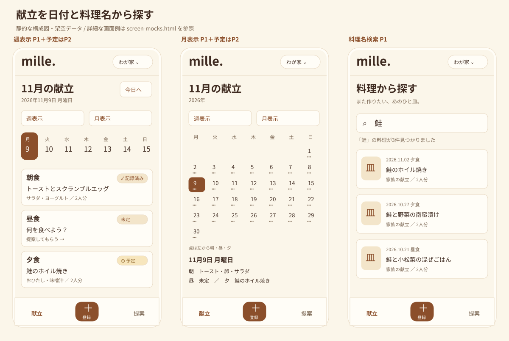
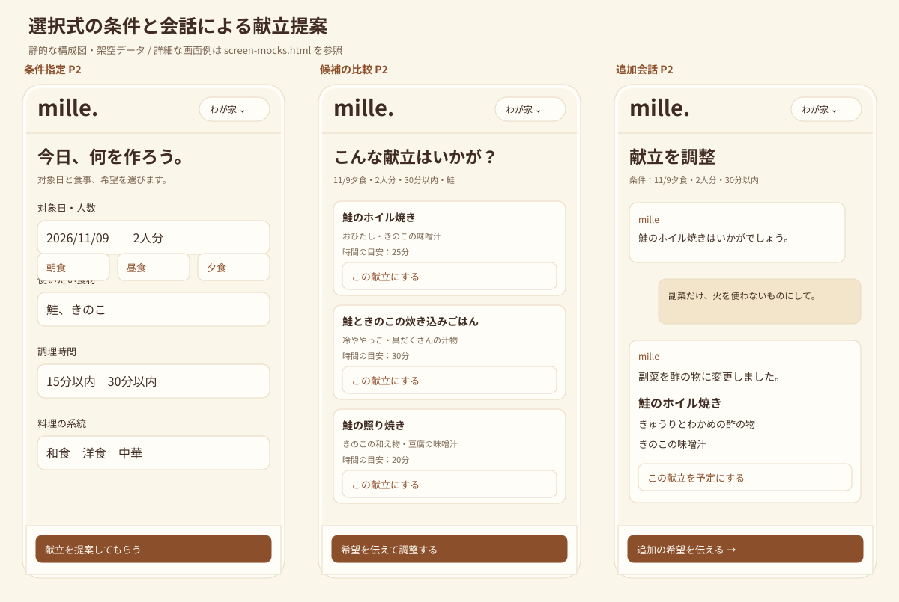
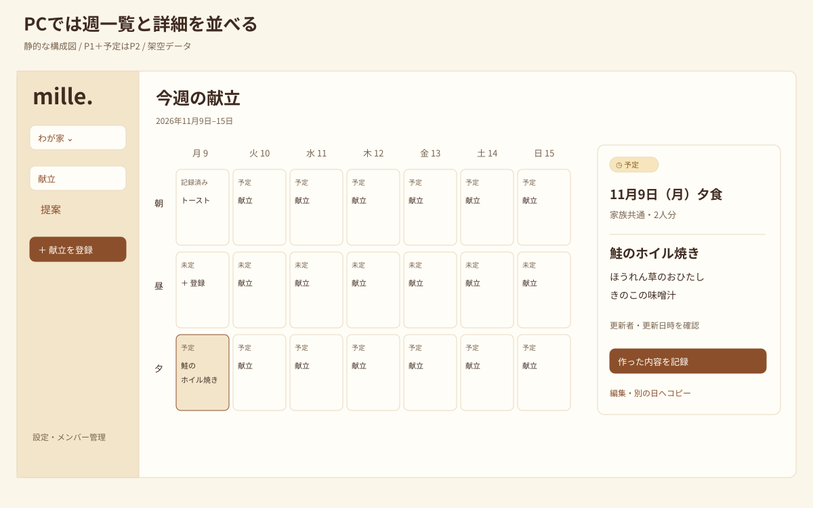

# mille 画面設計書

設計版：v0.2 / 文書保存日：2026年11月19日

本書と画像は、家族共通の献立を朝・昼・夕ごとに管理するための完成イメージを示す。画面モックはアプリ本体への実装完了を意味しない。P1の手動記録を先に完成させ、提案・写真・栄養を段階的に追加する。

詳細な静的画面例は[画面モックHTML](assets/screen-mocks.html)を参照する。HTMLはダウンロードして通常のブラウザで開ける。画像は配置の構成図であり、HTMLには検討用サンプルの画面を静的に保存している。

## 1 画面の基本構成

主な入口は「献立」「提案」と、常設の「＋登録」。「＋登録」は入力画面を開く操作で、閲覧用タブとは分ける。

ヘッダーには選択中のワークスペースを表示し、家族の共有場所を確認・切替できるようにする。メンバー管理・招待・名称変更などは設定から開く。

| 画面 | 主な役割 |
| --- | --- |
| 献立 | 週・月表示、料理名検索、選択日の朝昼夕 |
| 詳細 | その日の料理・材料・作り方、編集、コピー |
| 登録と編集 | 日付・食事区分を引き継いだ複数料理の入力 |
| 提案 P2 | 条件指定、候補比較、追加要望、予定への採用 |

## 2 ミルフィーユを意識した配色

milleはミルフィーユに由来する。クリームとカスタードの余白に、パイの層・黄金色・香ばしい焼き色を組み合わせる。

| トークン | 色 | 用途 |
| --- | --- | --- |
| Custard | #FBF6EA | 背景 |
| Cream | #FFFDF7 | カード・入力欄 |
| Pastry | #F3E5CA | 補助面・選択背景 |
| Gold | #C9964A | 装飾・ブランドの点 |
| Caramel | #8B4F2B | 保存・採用などの主操作 |
| Chocolate | #3F2B21 | 本文・見出し |
| Muted | #78634F | 補足文字 |
| Border | #E8D9C3 | 境界線 |

黄金色は装飾に使い、小さな文字や白文字の主ボタンには使わない。予定・記録済みは文字とアイコンでも区別する。本文14〜16px、入力16px、主な操作44px以上を設計基準とし、画面実装時に確認する。

## 3 献立の閲覧と検索

スマホの週表示は、横に7日分の日付と記録状況、その下に選択日の朝・昼・夕を縦に表示する。初期選択は今日とし、前後の日付への移動と「今日へ」を用意する。

月表示では各日の記録状況を印で示し、朝昼夕の対応が分かる凡例を付ける。選択日の詳細は下に表示する。P1は未記録・記録済み、P2から予定を加える。

料理名検索は「料理と作った日」の組で表示し、同じ料理でも別の日の記録を探せるようにする。未記録、読込中、取得失敗、検索結果なしは別の状態として表示する。

## 4 軽く登録して家族で見返す

必須は日付・食事区分・料理名。人数、材料・分量、作り方、参照URLは後から補完できる。1食に複数料理を追加でき、人数は家族のアカウント数と独立して扱う。

食材量は料理全体の量と明示し、不明でも保存できる。レシピは手入力とURLを切り替え、P1ではURLの内容を自動取得しない。

詳細から編集・削除・別の日へのコピーへ進む。コピー先の日付と食事を確認し、元の記録は変更しない。更新者と更新日時を表示する。

同時更新では自分の入力を保持し、最新版を確認してから再編集できるようにする。通信失敗でも入力を消さず、無条件の上書きや自動マージを行わない。

## 5 条件と会話から献立を決める P2

対象日・朝昼夕・人数、使いたい食材、調理時間、料理の系統、自由な要望を指定する。献立画面から開くと、選択日と食事区分を引き継ぐ。

候補は料理の構成、時間の目安、理由で比較する。画面例は3案だが、候補数は実装時の設計値として扱う。「副菜だけ変えたい」などを会話で伝え、現在の条件と変更後の候補を確認できるようにする。

採用は予定保存とし、作った内容を確認・修正して記録済みにする。記録済みは自動置換せず、予定の置換には確認を挟む。

## 6 PCでの配置

PCでは7日×朝昼夕の一覧と、選択した食事の詳細を左右に並べる。入力項目・状態・権限はスマホと共通にし、表示のために別の業務データを持たせない。

## 7 後続段階の画面

P3では写真添付と解析結果の確認画面を追加する。推定した材料・量を追加・削除・修正でき、分からない量は不明のまま保存する。解析失敗時も手入力を続けられる。

P4では料理詳細に栄養表示を加える。料理全量の何人分か、計算できた範囲、未対応・不明・推定を示し、個人の実際の摂取量と混同しない。

## 8 関連文書

- [要件書](../requirements.md)
- [技術詳細設計書](technical-design.md)
- [設計書の索引](README.md)
