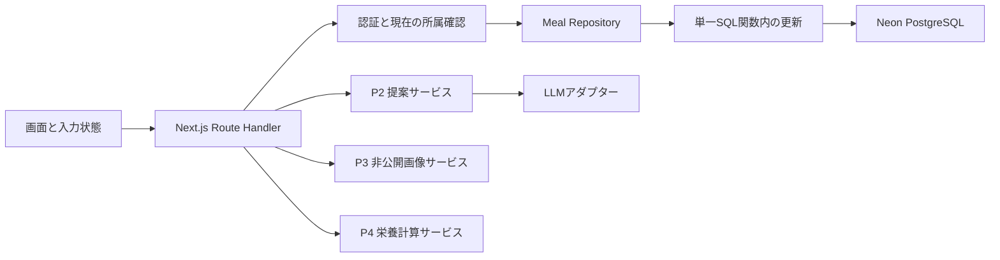
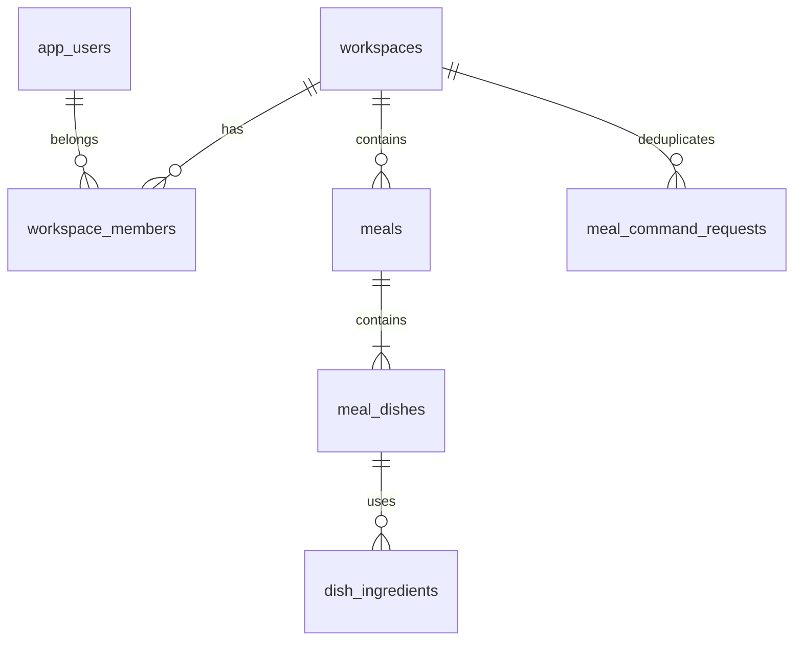
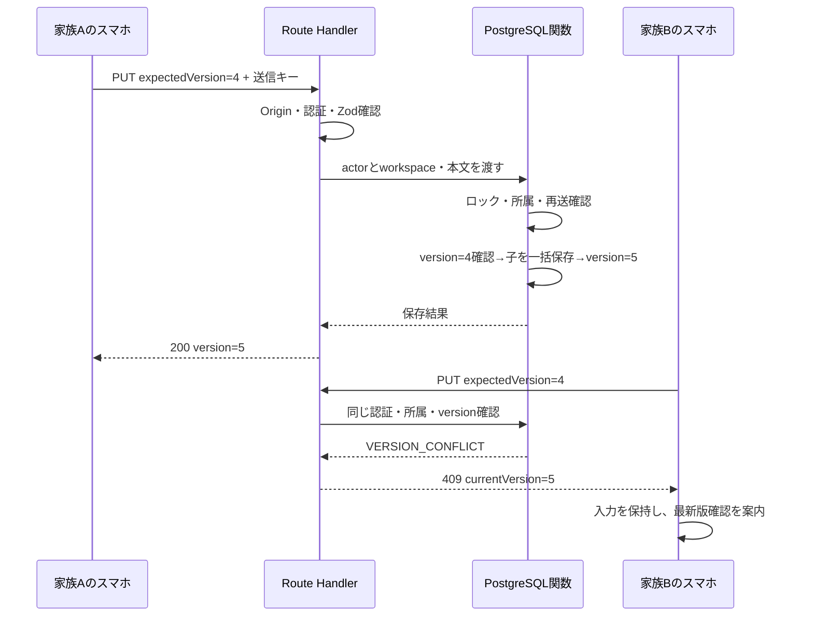

# mille 技術詳細設計書

設計基準日：2026年11月10日 / 文書保存日：2026年11月19日

関連文書：[要件書](../requirements.md)・[画面設計書](screen-design.md)・[設計書の索引](README.md)

家族共通の朝・昼・夕食を管理するmilleの技術詳細設計です。画面・機能設計で合意した方針に沿って、第1段階のDB・API・権限・更新手順を具体化し、提案・写真・栄養へ拡張する境界を定義します。

設計版 **v0.1** ／ 2026年11月10日 ／ **実装前の設計案**。件数・容量・期限などは初期の提案値です。

## 1 前提とアプリケーション構造

### 本書の位置づけ

家族共通の献立を朝・昼・夕ごとに記録し、履歴と希望から次の献立を決めるための技術設計案。画面設計 v0.2 と操作サンプル v0.3 を実装へ落とし込む。現行実装を調査した上で、これから追加する構造・契約・検証を定義する。DDL・API・数値上限は未適用の設計案であり、実装済みの機能とは区別する。

| 区分 | 内容 |
| --- | --- |
| 合意済みの業務範囲 | 家族が同じワークスペースを利用。1日×朝昼夕につき共通の1食、1食に複数料理。人数は任意。個人別の食事・取り分・摂取量は後続検討 |
| P1 | 手動登録・編集・削除、週／月表示、料理名検索、履歴コピー、レシピ本文またはURL |
| P2 | 条件と履歴からの提案、候補への追加要望、予定への採用、作った内容の記録 |
| P3 | 非公開の写真添付、写真からの入力補助、推定の確認・修正、食材名検索 |
| P4 | 食品成分表との対応、量・単位の換算、栄養表示、栄養を考慮した提案 |
| 設計提案値 | 件数・容量・期限・時間などの運用上限。受入条件とともに実装計画で確定する |

「未定／未記録」は献立行がない状態。P1の保存済み行は `RECORDED`、P2から `PLANNED` を追加する。予定の採用を、食べた実績の蓄積や栄養集計へ自動的に含めない。

### 現行構成と継承する部分

調査時点は `tyask/mille` の `44f3d11b765e3f3645471e80c0ccbf2c82d7f9e9`。Node 24.19.0、Next.js 16.4.3、React 19.2.8、TypeScript 6.0.3、Auth.js 5.0.0-beta.32、Zod 4.6.7、Neon上のPostgreSQL、Vercelで構成される。

| 現行の根拠 | 継承する設計 |
| --- | --- |
| `app/page.tsx` | Server Componentで認証・初期ワークスペースを取得。`force-dynamic`、`revalidate=0` |
| `lib/server/auth/current-user.ts` | Auth.jsの内部ID・メールから、DBの現在の有効状態を再確認 |
| `lib/server/workspace-http.ts` | 更新時の同一Origin確認、JSONをバイト数制限付きで読む、`private, no-store` |
| `lib/server/workspaces.ts` | 引数化したSQL、Repository境界、DBコマンド結果をDomainErrorへ変換 |
| `db/migrations/002_workspaces.sql` | SQL関数内で利用者・ワークスペースをロックし、所属と更新を同じDB処理で確認 |
| `scripts/db/sql.ts` とDB手順 | 環境marker・原文hash・migration履歴を照合。本番ではNext.jsのビルド成功後、公開前に未適用のmigrationを適用 |
| `scripts/cloud/` とCI | PGliteと架空A/Bによる検証。正式Neon／Vercel Previewと実Google OAuthを別に確認 |

既存のドライバー、認証方式、利用者登録方式を継承する。P1のためにORM、別の認証基盤、リアルタイム同期基盤を追加しない。

### アプリケーションの責務



Route Handlerは認証・Origin・入力検証・HTTP変換を担当する。Repositoryは検証済みの業務操作をDBコマンドへ渡す。SQL関数は現在の権限、一意性、期待version、冪等性、親子レコードの一括更新を保証する。ブラウザはSQLやDB接続情報を持たない。

P2以降のLLM・画像・栄養処理は別のサービス境界に置く。LLMの待機中にDBトランザクションやワークスペースの行ロックを保持しない。

### 追加するファイルの配置案

```text
app/
  page.tsx                         認証と初期データ取得
  api/workspaces/[workspaceId]/
    meals/                          P1の献立API
    dish-search/                  P1の料理名検索
    suggestions/                    P2の提案API
    images/                         P3の画像API
components/
  meals/
    meal-app.tsx                    選択ワークスペースと画面の境界
    meal-calendar.tsx               週・月・選択日の3食
    meal-editor.tsx                 複数料理と入力の保持
    meal-detail.tsx                 閲覧、編集、コピー
    dish-search.tsx                 検索とページング
lib/shared/
  meal-types.ts                    DTOと列挙値
  meal-schemas.ts                  Zodスキーマと上限
lib/server/
  meals.ts                         Repositoryと業務エラー
  meal-http.ts                     献立APIのHTTP境界
  suggestions/                     P2の履歴集約・モデル境界
  images/                          P3の保存・確認・削除
  nutrition/                       P4の成分表対応と計算
db/migrations/
  003_meals.sql                    P1の追加案
  004_suggestions.sql              P2の追加案
  005_meal_images.sql              P3の追加案
  006_nutrition.sql                P4の追加案
```

番号は現時点の次番案。実装時には取得した最新mainのmigration履歴を確認して確定する。適用済みのSQLを編集して番号を使い回さない。

### 画面状態と通信の扱い

スマホの主導線は「献立／＋登録／提案」。PCは同じデータを週一覧と詳細の左右配置で表示する。画面URLは例として `/?workspace=...&date=2026-11-10&view=week&meal=DINNER` とし、日付・表示・食事・ワークスペースを再読込や戻る操作で復元する。料理名、食材、会話、レシピ本文はURLへ含めない。

Server Componentは認証と最初の所属・表示範囲を確定し、Client Componentへシリアライズ可能なDTOを渡す。Client Componentは入力途中の状態、通信中、エラー、競合を保持する。ルートの選択状態だけで所属権限を判定しない。

| 状態 | 振る舞い |
| --- | --- |
| 登録中 | 入力はコンポーネント内に保持。保存が失敗しても消さない。日付・食事・料理名だけで保存可 |
| 未保存で画面を離れる | アプリ内の移動・ワークスペース切替は確認する。専用の永続下書き機能はP1に追加しない |
| 保存中 | 同じ操作ボタンの二重押下を抑止。再試行は同じIdempotency-Keyと同じpayloadを使う |
| 更新競合 | 自分の入力を残し、最新の内容・更新者・時刻を取得。自動マージや無条件上書きをしない |
| ワークスペース切替 | 進行中のfetchを中断。遅れて届いた旧workspaceの応答はrequest番号とworkspace IDで破棄 |
| 表示の更新 | 保存応答を反映し、関係する期間一覧・詳細・検索を再取得。P1は再表示・明示更新で他の家族の変更を取得 |
| 日付 | 食事日はタイムゾーンのない`YYYY-MM-DD`。今日の初期値は`Asia/Tokyo`。監査時刻はUTCのISO 8601で返し、表示時に日本時間へ変換 |

カレンダーの範囲取得は要約DTOを返す。材料・作り方を全日分まとめて返さず、詳細画面でその1食だけ取得する。週・月・検索を別々の業務データとして持たない。

### ミルフィーユを意識したデザイントークン

| トークン案 | 値 | 用途 |
| --- | --- | --- |
| `--color-custard` | `#FBF6EA` | 背景 |
| `--color-cream` | `#FFFDF7` | カード・入力欄 |
| `--color-pastry` | `#F3E5CA` | 補助面・選択の背景 |
| `--color-gold` | `#C9964A` | 装飾・ブランドの点 |
| `--color-caramel` | `#8B4F2B` | 主操作・選択日 |
| `--color-chocolate` | `#3F2B21` | 本文・見出し |
| `--color-muted` | `#78634F` | 補足文字 |
| `--color-border` | `#E8D9C3` | 境界線 |

主操作の茶色とクリーム色は約6.35:1、本文と背景は約12.33:1。黄金色は小さな文字や白文字ボタンに使わない。予定・記録済みは文字とアイコンでも区別する。既存`app/globals.css`と`app/layout.tsx`の`themeColor`は、P1の画面実装時に合わせて更新する設計とする。

## 2 データモデルとトランザクション

### データモデルと保存単位

#### 既存基盤への追加

既存の `app_users.id`、`workspaces.id` は `text`、ワークスペースIDの既定値は `gen_random_uuid()::text` である。新規の献立・料理・食材IDもこの形式にそろえる。既存の共有メンバーに新しい編集ロールを追加せず、所属する有効な利用者が閲覧・編集できる。

| テーブル | 段階 | 役割と主な項目 |
| --- | --- | --- |
| `meals` | P1 | 1日の朝・昼・夕それぞれの献立。ワークスペース、食事日、区分、人数、更新版番号、作成・更新者を持つ |
| `meal_dishes` | P1 | 献立を構成する料理。料理名、表示順、人数の個別指定、作り方または参照URLを保存 |
| `dish_ingredients` | P1 | 料理に使用した食材の原文。食材名、分量文字列、単位、表示順を保存 |
| `meal_command_requests` | P1 | 同じ更新の再送を検出する冪等キー、入力ハッシュ、成功結果を保存 |
| 提案セッション・候補 | P2 | 指定条件、参照した実績の版、候補、会話。採用前は献立にしない |
| 画像・解析処理 | P3 | 非公開オブジェクトの識別子、対象料理、解析状態、確認済みの推定結果 |
| 標準食品・栄養計算 | P4 | 成分表の版、食品との対応、換算重量、対象材料と計算結果 |



`UNIQUE(workspace_id, meal_date, meal_type)` で1食1件を保証する。`meal_date` は PostgreSQL の `date` とし、APIも `YYYY-MM-DD` をそのまま受け渡す。食事日をUTCの深夜時刻に変換しない。更新日時は `timestamptz` で保存し、画面では日本時間で表示する。

#### P1の型と制約

以下は移行ファイルに落とすためのDDL例であり、本設計作成時には適用しない。上限は運用初期の提案値で、APIとDBを同時に変更する。

```sql
CREATE TABLE meals (
  id text PRIMARY KEY DEFAULT gen_random_uuid()::text,
  workspace_id text NOT NULL
    REFERENCES workspaces(id) ON DELETE CASCADE,
  meal_date date NOT NULL,
  meal_type text NOT NULL
    CHECK (meal_type IN ('BREAKFAST','LUNCH','DINNER')),
  status text NOT NULL DEFAULT 'RECORDED'
    CHECK (status IN ('RECORDED')),
  servings numeric(6,2)
    CHECK (servings > 0 AND servings <= 99),
  version integer NOT NULL DEFAULT 1 CHECK (version > 0),
  created_by text NOT NULL REFERENCES app_users(id),
  updated_by text NOT NULL REFERENCES app_users(id),
  created_at timestamptz NOT NULL DEFAULT now(),
  updated_at timestamptz NOT NULL DEFAULT now(),
  UNIQUE (workspace_id, meal_date, meal_type)
);

CREATE TABLE meal_dishes (
  id text PRIMARY KEY DEFAULT gen_random_uuid()::text,
  meal_id text NOT NULL REFERENCES meals(id) ON DELETE CASCADE,
  position smallint NOT NULL CHECK (position BETWEEN 0 AND 19),
  name text NOT NULL
    CHECK (name = btrim(name) AND char_length(name) BETWEEN 1 AND 120),
  servings numeric(6,2)
    CHECK (servings > 0 AND servings <= 99),
  recipe_text text CHECK (char_length(recipe_text) <= 10000),
  recipe_url text CHECK (char_length(recipe_url) <= 2048),
  CHECK (recipe_text IS NULL OR recipe_url IS NULL),
  CONSTRAINT meal_dishes_position_uq
    UNIQUE (meal_id, position) DEFERRABLE INITIALLY DEFERRED
);

CREATE TABLE dish_ingredients (
  id text PRIMARY KEY DEFAULT gen_random_uuid()::text,
  dish_id text NOT NULL REFERENCES meal_dishes(id) ON DELETE CASCADE,
  position smallint NOT NULL CHECK (position BETWEEN 0 AND 99),
  name text NOT NULL
    CHECK (name = btrim(name) AND char_length(name) BETWEEN 1 AND 120),
  amount_text text CHECK (char_length(amount_text) <= 40),
  unit text CHECK (char_length(unit) <= 20),
  CONSTRAINT dish_ingredients_position_uq
    UNIQUE (dish_id, position) DEFERRABLE INITIALLY DEFERRED
);

CREATE INDEX meals_workspace_date_idx
  ON meals(workspace_id, meal_date DESC, id DESC);

CREATE TABLE meal_command_requests (
  workspace_id text NOT NULL
    REFERENCES workspaces(id) ON DELETE CASCADE,
  actor_id text NOT NULL REFERENCES app_users(id),
  request_key text NOT NULL CHECK (char_length(request_key) BETWEEN 1 AND 128),
  operation text NOT NULL,
  request_hash text NOT NULL CHECK (request_hash ~ '^[a-f0-9]{64}$'),
  response_json jsonb NOT NULL,
  created_at timestamptz NOT NULL DEFAULT now(),
  expires_at timestamptz NOT NULL DEFAULT now() + interval '24 hours',
  PRIMARY KEY (workspace_id, actor_id, request_key)
);
```

料理は1〜20件、材料は料理ごとに0〜100件とする。配列の件数、料理が1件以上存在すること、位置番号の重複はSQLコマンドでも検証する。`position` の一意制約は、料理の並べ替え途中の一時衝突を避けるため遅延制約とする。

人数は任意で `null` を許可し、0.01〜99、小数第2位までとする。「0.5人分」は料理の総調理量の単位で、特定の家族の摂取量を意味しない。DBの `numeric` はAPIのJSON numberとの境界で範囲・桁数を検証し、丸めて受け入れない。料理の `servings` が `null` の場合は献立の人数を継承する。両方 `null` の場合は人数不明として表示する。人数だけを変更しても材料量を自動で倍率変更せず、必要な量は利用者が確認して編集する。

#### 分量とレシピとIDの扱い

P1の分量は `amountText: string | null` をそのまま保存する。`"200"` と単位 `"g"`、`"1/2"` と `"個"`、`"少々"` と単位なしを扱える。不明は `null` とし、`"0"` と区別する。P1ではこの文字列を栄養計算の数値と見なさない。P4で食品との対応と換算重量を別に追加し、原文は残す。

作り方と参照URLは排他で、どちらも未入力にできる。URLはサーバーで `http` / `https` の絶対URLとして検証し、P1では取得・解析しない。材料・量・作り方は記録に複製した値であり、将来レシピの標準値を編集しても過去の記録は変わらない。利用者が履歴自体を編集した場合は、その履歴の現在値と版番号を更新する。全版の監査履歴はP1に追加しない。

PUTは献立全体の置換として扱うが、既存の料理・材料IDは親の所属をDBで確認したうえで保持する。IDなしの要素だけ新規作成し、配列から消えた要素を削除する。他の献立の子IDの持ち込みは拒否する。食事全体のコピーでは献立・料理・材料すべてに新しいIDを発行する。料理単位のコピーでも追加する料理・材料には新しいIDを発行し、コピーは同じワークスペース内に限定する。

### 更新とコピーと削除のトランザクション

#### 単一SQL関数で完結させる

既存の `createQuery()` はNeon HTTPまたはローカルsidecarに1つのSQLを送る形式で、接続を維持した `BEGIN` → 複数の `query()` → `COMMIT` を提供していない。P1は既存の `mille_workspace_command` と同様に、`mille_meal_command(actor_id, actor_email, operation, payload)` を1回呼び出す。料理・材料の保存、版更新、冪等結果の保存を同じトランザクションで行う。

変更コマンドの順序は、利用者行のロック → ワークスペース行のロック → 所属の照合 → 冪等キーの確認 → 対象献立行とする。再送を枠や期待版の競合より先に判定し、直前の成功で対象が変更・削除済みでも同じ結果を返せるようにする。利用者とワークスペースを `FOR UPDATE` でロックし、DB内で現在の利用可否・Productionのテスト利用者禁止・所属を再確認する。対象献立が複数あればID順でロックする。家族内の書き込みをワークスペース単位で直列化する方式をP1では採用する。既存ワークスペース削除も同じワークスペース行をロックするため、削除と登録が中途半端に交差しない。

| 操作 | DB内で保証すること |
| --- | --- |
| 新規登録 | 同じ日付・朝昼夕があれば既存記録を上書きせず409を返す。競合する同時INSERTも一意制約で防ぐ |
| 更新・実績化 | `expectedVersion` と現在の `version` を比較。違えば409。子の反映後に `version + 1`、更新者・時刻を設定 |
| 日付・食事変更 | 同じIDでも、移動先の別の献立があれば409。元の記録は移動しない |
| 食事全体のコピー | 元の所属・版を確認して全内容を複製。コピー先が使用中、またはコピー元と同じ枠なら409 |
| 削除 | 所属と版を確認して献立を物理削除。子料理・材料はCASCADE。家族の新しい編集を古い版で削除しない |

ドメインエラーをJSONで返すだけでは、それ以前のDMLはロールバックされない。全入力の検証を先に済ませ、変更処理を1つの内側 `BEGIN … EXCEPTION … END` ブロックに置く。途中の制約違反をドメインエラーに変換する場合は、そのブロック全体の変更をロールバックしてから返す。遅延一意制約は、同じ内側ブロックの成功確定前に `SET CONSTRAINTS meal_dishes_position_uq, dish_ingredients_position_uq IMMEDIATE` で検査し、commit時まで失敗を持ち越さない。制約名を見て「枠の衝突」など判定可能なものだけ409へ変換し、未知のDB障害を入力エラーに偽装しない。

#### 冪等性と削除済みデータ

`meal_command_requests` のキーは `(workspace_id, actor_id, request_key)`。操作・対象ID・正規化後payload・期待版を含むSHA-256と、成功応答JSONを保存する。キーの有効期間は24時間を提案する。同じキー・同じ入力の再送は同じ成功応答を返し、異なる入力は409。失敗した操作は成功記録として保存しない。毎回、現在の利用可否と所属を確認してから過去の成功結果を返す。

同じDELETEの再送は冪等キーにより成功応答を再現する。キーのない別操作で削除済みIDを指定した場合は404とし、存在しないIDと所属外IDの区別を外部へ出さない。ワークスペース削除では献立と冪等結果をCASCADEで削除する。利用者の無効化では履歴を消さず、作成・更新者の参照を保持する。献立の削除で直ちに消えるのは業務テーブルの親子であり、別操作の過去の成功応答には削除前の内容が再送用に残り得る。24時間は応答再現の有効期限であって物理削除の保証時刻ではない。期限切れ結果は管理用保守で削除し、実行間隔をP1の運用計画で確定する。保持中の応答も通常の個人データと同じ所属確認で保護する。P1のために新しい常駐ジョブ基盤は導入しない。

### 読み取りと検索と段階追加

週・月表示は現在のワークスペースと最大62日の範囲で取得し、カレンダーには料理名と状態など必要な項目を返す。材料・長い作り方は詳細取得で返す。1つのSQL文で、現在有効な利用者と所属をJOIN／EXISTS確認してから対象データを取得する。認可のために全家族の献立を取得してアプリ側で絞り込む実装にはしない。

P1の料理名検索は、記録した料理名の部分一致に限定する。LIKEの `%`・`_`・エスケープ文字をリテラル検索用に処理し、検索値はパラメーター化する。結果は料理×記録日単位で、同じ料理を別日に作れば別件となる。既定20件・最大50件、順序は食事日降順・献立ID降順・料理位置昇順・料理ID昇順とし、同じ順序のカーソルで次ページを取得する。カーソルはワークスペースと検索語に結び付け、内部値も検証する。初期は日付・親子の索引を利用し、`pg_trgm` や日本語全文検索は実測後の追加とする。

| 段階 | 追加内容と既存データの扱い |
| --- | --- |
| P2 | `status` に `PLANNED` を追加。既存は `RECORDED` のまま。候補は別テーブルに保存し、採用時だけ予定を作る。記録済みの枠は置換せず、既存予定は確認と期待版が一致した場合のみ置換する |
| P3 | 画像・解析結果・推定／確認状態を追加。解析完了時に古い料理版へ自動上書きせず、確認して変更コマンドへ渡す。削除済み料理への結果反映は拒否する |
| P4 | 分量原文を残したまま、標準食品、換算重量、成分表の版、栄養結果の計算対象を追加。料理版または材料対応が変われば以前の計算を最新値として使わない |

### マイグレーションと復旧

既存の `001_auth.sql` と `002_workspaces.sql` は変更せず、P1は次の連番 `003_meals.sql` を追加する。実装時には新規テーブル・索引・関数・必要な制約を同じ移行に含め、`generate-sql.ts` から生成する初期化SQLとローカルPGlite側にも反映する。

既存の移行runnerは、専用DB markerのproject・環境・環境ID、全既存移行のSHA-256、`schema_migrations` を確認し、`pg_advisory_xact_lock(hashtext('mille:schema'))` の下で適用する。移行全体がDO文の単一トランザクションなので、`CREATE INDEX CONCURRENTLY` は混ぜない。P1は空の追加テーブルへの通常の索引作成で足りる。

適用前はローカルPGliteと専用Previewで、空DBからの初期化と002からの増分移行の両方を確認する。Vercelの`main`本番ビルドでは、Next.jsのビルド成功後、公開前に未適用のmigrationを適用する。初期化とseedは専用手順で扱う。移行に成功してから新しいアプリへ切り替えるまで、公開中の旧アプリも新しいスキーマを利用できる順序にする。 [本番ビルドとDB移行](../development.md#本番ビルドと-db-移行)

失敗した移行はトランザクションのロールバックを確認する。適用成功後に不具合が分かった場合は、以前のアプリへ戻して新しいデータを保持し、追加の修正migrationで直す。適用済みSQLの書換えや、利用開始後のテーブルDROPを標準的な巻戻し手段にはしない。正式な復元が必要な場合は対象DBと復元点を別途照合する。

## 3 APIと認証と更新契約

### APIとデータ契約

以下は実装前の契約案である。既存のApp Router、Auth.js、Zod、パラメーター付きSQLを継承し、献立用のRoute HandlerとRepositoryを追加する。P1の手動記録を完成させ、P2以降のAPIは対応する段階で追加する。

#### P1のエンドポイント

基点は `/api/workspaces/{workspaceId}` とする。`workspaceId` と `mealId` は既存DBに合わせたtext IDであり、URLから受け取った値自体は権限を証明しない。

| Method | パス | 処理と成功応答 |
| --- | --- | --- |
| GET | `/meals?from=2026-11-01&to=2026-12-01` | 日付範囲の一覧、200。from以上・to未満 |
| POST | `/meals` | 記録を新規作成、201。既存の同日・同食事は409 |
| GET | `/meals/{mealId}` | 料理・材料・レシピを含む詳細、200 |
| PUT | `/meals/{mealId}` | 一食の内容を全置換、200。子料理も一括保存 |
| DELETE | `/meals/{mealId}` | バージョン確認後に削除、204 |
| POST | `/meals/{mealId}/copies` | 別の日・食事へ独立した記録を作成、201 |
| GET | `/dish-search?q=鮭&limit=20&cursor=...` | 料理名の検索、200。1料理×記録日が1結果 |

カレンダー一覧は日付・食事区分・料理名・人数・状態・version・更新者の要約を返す。レシピ本文や全材料は詳細APIで取得し、月表示で全詳細を取得しない。空の日は一覧に存在しないことで表し、未所属と取得失敗を「記録なし」に変換しない。

#### 作成と更新のJSON

P1の作成例。`mealDate` は日付だけの `YYYY-MM-DD`、`mealType` は `BREAKFAST / LUNCH / DINNER`。`servings` は料理全体の人数で、アカウント数や個人の摂取量ではない。料理側がnullなら献立の人数を表示上の初期値に使う。

```json
{
  "mealDate": "2026-11-10",
  "mealType": "DINNER",
  "servings": 2,
  "dishes": [
    {
      "name": "鮭のホイル焼き",
      "servings": null,
      "recipeText": "鮭と野菜を包んで蒸し焼きにする。",
      "recipeUrl": null,
      "ingredients": [
        {"name": "鮭", "amountText": "200", "unit": "g"},
        {"name": "玉ねぎ", "amountText": "1/2", "unit": "個"},
        {"name": "塩", "amountText": "少々", "unit": null},
        {"name": "油", "amountText": null, "unit": null}
      ]
    }
  ]
}
```

人数・材料・分量・レシピは未入力で保存できる。POSTでは任意項目の省略をnull、材料の省略を空配列へ正規化する。任意文字列は前後空白を除いて空ならnullとし、作り方の内部改行は保持する。`amountText` は原文を残し、不明はnullとする。「少々」を0gや数値0へ変換しない。P4で数値・換算重量を別に追加する。`recipeText` と `recipeUrl` は両方null可、両方非nullは不可。URLは資格情報を含まないHTTP/HTTPSだけを許可し、P1ではサーバーから参照先を取得しない。

201/200の詳細応答は次の形とする。DBが採番・作成した値はクライアントから指定させない。

```json
{
  "meal": {
    "id": "meal_opaque_id",
    "workspaceId": "workspace_opaque_id",
    "mealDate": "2026-11-10",
    "mealType": "DINNER",
    "servings": 2,
    "status": "RECORDED",
    "version": 1,
    "dishes": [
      {
        "id": "dish_opaque_id",
        "position": 0,
        "name": "鮭のホイル焼き",
        "servings": null,
        "recipeText": "鮭と野菜を包んで蒸し焼きにする。",
        "recipeUrl": null,
        "ingredients": [
          {"id": "ingredient_opaque_id_1", "name": "鮭", "amountText": "200", "unit": "g"},
          {"id": "ingredient_opaque_id_2", "name": "玉ねぎ", "amountText": "1/2", "unit": "個"},
          {"id": "ingredient_opaque_id_3", "name": "塩", "amountText": "少々", "unit": null},
          {"id": "ingredient_opaque_id_4", "name": "油", "amountText": null, "unit": null}
        ]
      }
    ],
    "updatedBy": {"id": "user_opaque_id", "name": "はる"},
    "updatedAt": "2026-11-10T10:20:00.000Z"
  }
}
```

PUTは作成と同じ本文に `expectedVersion` を加え、nullable項目もnullを明示する完全なデータを送る。既存の料理・食材の `id` は返却値を保持し、追加行だけidを省略する。配列順を表示順とし、省かれた子は削除する。別の献立・料理に属するidの持込みは拒否する。P1のstatusはサーバーで `RECORDED` 固定、P2でも通常PUTから自由に変更させない。

DELETEの本文は `{"expectedVersion":4}`。食事全体のコピーの本文は `{"sourceVersion":4,"targetDate":"2026-11-10","targetMealType":"DINNER"}` とする。コピー先が埋まっていれば409を返し、元・先とも変更しない。子idも新規採番し、コピー後の編集が元の材料や作り方へ波及しない。

#### 料理単位のコピーは編集画面で確認して保存する

料理だけのコピーは、既存のGETとPOST／PUTを使う入力補助とする。専用のコピーAPIで即時確定する食事全体のコピーとは、操作を分ける。

1. 同じワークスペースの元献立を詳細GETし、料理を選ぶ。料理名・材料・分量原文・単位・レシピと、取得時のsource meal ID／versionを編集中の画面に保持する。
2. コピー先の日付・朝昼夕を選び、枠が空なら新規編集を開く。既存の献立があれば最新版をGETし、その料理配列の末尾に選択した料理を追加する。既存料理・材料のIDと順番は保持し、コピーする料理・材料のIDとpositionは取り除く。
3. 人数と内容を確認して通常のPOST／PUTで保存する。元料理の人数がnullなら元献立の人数を引き継いだ実効人数をコピー先料理へ明示する。元の実効人数も不明な場合はその旨を表示し、コピー先の人数を使うか、人数を補完するかを保存前に確認する。材料量は自動で倍率変更しない。

POSTは空枠の競合を409で拒否する。PUTはコピー先のexpectedVersionを必須にし、古ければ409として追加中の料理を画面に残す。表示順は送信配列順、追加後も最大20料理・各100材料を守り、親子全体の保存と冪等結果を同じSQLコマンドで確定する。同じキー・同じ本文の再送で料理が重複追加されない。

この操作が保存するのは、利用者が取得・確認して編集した料理のスナップショットである。元の献立がその後変更されても入力を自動更新せず、保存時に元の最新versionとの一致は要求しない。source ID／versionは入力の由来の表示用で、通常POST／PUTの権限証明や未知フィールドとして送らない。コピー元は更新しない。ワークスペースを切り替える場合は未保存確認を行い、コピー入力を別ワークスペースへ持ち越さない。

#### 入力制限と検索

以下は初期の設計提案値であり、利用状況と実装時の検証で調整する。

| 対象 | 制限案 |
| --- | --- |
| 献立JSON本文 | 実受信256KiB以下。Content-Lengthの有無に依存しない |
| 料理・食材 | 一食20料理以下、各料理100食材以下。空の料理名は不可 |
| 名前・分量原文 | 料理名・食材名はtrim後1〜120文字、amountTextは40文字以下、unitは20文字以下 |
| 人数 | null、または0.01〜99の数値。小数2桁まで |
| 作り方 | 料理ごと10,000文字以下。URLは2,048文字以下 |
| カレンダー取得 | 1要求62日以内。実在する日付を検証 |
| 検索 | qは1〜100文字、limit既定20・最大50 |

個々の文字数・件数以内でも、本文全体の256KiBを超えた場合は拒否する。`readWorkspaceJson` の既存16KiBをグローバルに緩めず、既定値を維持したbounded readerに献立API用の上限を渡す。Zodのstrict objectで未知のフィールド、クライアント指定status、負数・不正日付を拒否する。制限のうちDBでも表現できる条件は二重に検証する。

料理名は部分一致。P1は同義語・栄養・食材名による検索を含めない。ILIKEの `%`・`_`・escape文字をエスケープし、値は必ずSQLパラメーターとして渡す。結果は `mealDate DESC, mealId DESC, dish.position ASC, dishId ASC` で並べ、次ページcursorに4要素とworkspace・検索条件の識別値を入れる。cursorは認可情報とせず、再送時に型・上限・条件一致・現在の所属を検証する。並行編集時の完全な検索スナップショットは保証せず、必要時に再検索する。

### 認証と権限とエラー応答

`getCurrentUser()` はセッションだけで完結せず、内部ID・正規化メール・有効状態をDBで再確認している。この入口と環境markerの検証を継承する。新Repositoryも、全query/commandで現在有効なactorとworkspace所属を同じSQLの条件に含める。OWNER/MEMBERによる新しい編集差は追加せず、共有の所属者が閲覧・編集できる。

書込みは既存の `assertWorkspaceSameOrigin` を再利用する。Originが正規originと一致せず、またはSec-Fetch-Siteがcross-siteなら403。Cookie認証APIで外部originへのCORS許可を追加しない。読み取りでも所属を再確認し、ワークスペースを切り替えただけで別家族のデータが参照できないようにする。

すべての成功・エラー応答に既存と同じ `Cache-Control: private, no-store, max-age=0, must-revalidate` と `Vary: Cookie` を付ける。Route Handlerは `dynamic = "force-dynamic"` / `revalidate = 0`、利用者別データを共有キャッシュや静的生成へ載せない。

| HTTP | code例 | 意味・画面の対応 |
| --- | --- | --- |
| 400 | `INVALID_INPUT` | Zod・形式違反。既存APIと合わせ、422へ変更しない |
| 401 | `UNAUTHENTICATED` | 未ログイン・利用停止。再ログインへ |
| 403 | `ORIGIN_REJECTED` | 書込み元が不正 |
| 404 | `NOT_FOUND` | 存在しない、未所属、別workspaceのIDを一律に扱う |
| 409 | `VERSION_CONFLICT` | 他の家族が更新。入力を保持し最新版確認へ |
| 409 | `SLOT_OCCUPIED` / `IDEMPOTENCY_KEY_REUSED` | 同日・同食事の重複、またはキーの不正再利用 |
| 413 | `BODY_TOO_LARGE` | 本文上限超過 |
| 500 | `INTERNAL_ERROR` | 詳細を隠した一般エラーとrequestId |

新しい献立APIは既存互換の `error` 文字列を残し、機械判定用codeとrequestIdを付加する。既存ワークスペースAPIの応答を一括変更しない。

```json
{
  "error": "ほかの家族がこの献立を更新しました。最新版を確認してください。",
  "code": "VERSION_CONFLICT",
  "requestId": "request_opaque_id",
  "currentVersion": 5
}
```

所属確認に成功した競合だけcurrentVersionを返す。SQL・スタック・メール・写真URL・セッショントークンはエラーに含めない。既存 `getCurrentUser` が認証取得失敗をnullへまとめる点は継承範囲とし、認証成功後のDB障害を未記録扱いにしない。

### 更新競合と二重送信

献立のversionは一食全体の更新単位とする。PUT・DELETE・実績化でexpectedVersionを必須にし、古い値なら409。日付や食事区分の変更先が他の献立で埋まっている場合も409。409ではサーバー・クライアントとも自動マージしない。画面は自分の入力と最新版を別に保持し、最新版を読み込む前に入力を捨てない。

書込みはactor→workspaceの順でロックし、所属を再確認する。次にidempotencyを照合し、対象mealをロックして全検証を行う。子料理・材料の保存、version増加、更新者、送信キーの結果保存までを1回のPostgreSQL関数呼出し・1トランザクションで完結させる。HTTPクエリーごとのBEGIN/COMMITを組み合わせない。例外を業務JSONへ変換する場合、途中の書込みをinner blockの例外処理でロールバックしてから返す。

全書込みに `Idempotency-Key` を付け、画面は送信開始時にUUIDを生成する。同じ操作の通信再試行は同じキー・本文、新たな編集確定は新しいキーとする。DBの一意キーはworkspace＋actor＋key、request hashはmethod・対象パス・検証後の正規化JSONから作る。同キー・同hashは元の応答を返し、同キー・別hashは409。既存slotやversion判定より先に再送を処理し、成功応答だけ失われたPOST/DELETEも再実行しない。

再送でもactor・所属確認を省略しない。保持期間は24時間を提案し、期限後の同じ応答の再現は保証しない。期限後は最新状態を確認し、新規操作として通常のversion・slot制約を適用する。再送応答は元の結果であって最新状態ではないため、クライアントは完了後に最新詳細を再取得する。送信結果には必要な応答だけを保存し、写真やLLM生応答を含めない。



workspace削除も同じ親行のロックに従うため、保存と削除は直列化される。利用停止はactorのロックで直列化する。所属削除を将来追加する際もworkspaceロックを先に取り、確認と書込みの間で所属だけを変更させない。失効と並行した処理はロック取得順に完了または拒否し、既に相手へ返した応答を後から回収する保証は持たせない。

## 4 提案と写真と栄養の拡張

### P2 提案と会話の内部契約

#### 提案APIとモデル境界

提案条件は、対象日、食事区分、人数、使いたい食材、調理時間、料理の系統、自由な要望。選択式と自由文を同じ入力オブジェクトで扱い、会話後も現在の条件を返す。

| API案 | 用途 |
| --- | --- |
| `POST /api/workspaces/{workspaceId}/suggestions` | 条件から新しい提案を生成 |
| `GET /api/workspaces/{workspaceId}/suggestions/{suggestionId}` | 生成状態・現在version・候補を取得 |
| `POST .../suggestions/{suggestionId}/messages` | 期待versionと追加要望で候補を修正 |
| `POST .../suggestions/{suggestionId}/adoptions` | 指定candidate IDを予定として採用 |
| `POST .../meals/{mealId}/recordings` | 作った内容を確認し、予定を記録済みへ変更 |

`RecommendationProvider.generate(context)`などのアダプターを定義し、モデル固有のSDKはその内側に閉じる。LLM提供元・モデル名・画像保存先はまだ選定しない。実装時に料金・地域・データ取り扱い・速度を比較し、環境ごとのサーバー設定で選ぶ。

モデルには、直近14日・最大42食の記録済みの履歴から、料理名の最大120件、食材の利用頻度、最後に使った日を上限付きで集約して渡す（提案値）。予定・他ワークスペース・メール・認証情報は含めない。履歴が空でも指定条件だけで提案できる。候補の理由に使う履歴情報はサーバーが集計する。

出力は構造化データとしてZod等で検証し、原文をそのまま保存・表示しない。

```typescript
type Candidate = {
  id: string;                       // サーバーが割り当てる
  title: string;
  estimatedMinutes: number | null;
  dishes: Array<{
    name: string;
    role: "MAIN" | "SIDE" | "SOUP" | "OTHER";
    ingredients: Array<{ name: string; amountText: string | null; unit: string | null }>;
    recipeText: string | null;
    recipeUrl: string | null;
  }>;
  reasons: string[];
  provenance: { kind: "HISTORY" | "GENERATED"; sourceMealId: string | null };
};
```

由来が履歴の場合、source IDが現在のワークスペースに属することをサーバーで解決する。生成した作り方は生成案と表示し、未確認のレシピURLを作らない。栄養未計算の候補に、栄養面の保証を付けない。自由文やレシピ本文はモデルへの入力データとして区切り、SQL実行・秘密取得・外部URLへのアクセス権を与えない。

#### 外部呼び出しと失敗時の扱い

提案要求にはrequest ID、入力hash、status、期限、prompt版、model識別子を保存する。最初のDB処理で実行権を確保して確定し、その後にモデルを呼ぶ。結果は別のDB処理で現在の所属とversionを再確認して保存する。

生成要求の状態は`RUNNING / SUCCEEDED / FAILED / EXPIRED`。この状態と、最後に確定した候補のversionは別に持つ。同じIdempotency-Keyの再送は、成功結果または現在の要求状態を返し、勝手にもう一度モデルを呼ばない。最初の要求は結果を待って201で返し、実行中の再送は202とsuggestionId・requestIdを返す。応答が失われてIDが分からない場合も、同じPOSTとキーを再送してからGETで確認できる。並行する会話更新は1つに制限し、古い会話の応答で新しい候補を上書きしない。新候補の確定前は採用を抑止し、失敗時は直前に確定した候補を保持する。

モデル待機25秒・サーバー処理上限30秒・実行lease60秒を初期の提案値とする。P2はリクエスト内で結果確定まで待つ方式から始め、完了していない処理をfire-and-forgetで残さない。途中でクライアントが切断した場合も、同じrequest IDの取得で結果を確認する。プロセス停止でRUNNINGが残れば期限後にEXPIREDとして扱い、利用者が新しい送信キーで明示的に再実行する。結果確定はRUNNINGかつ有効lease・期待版が一致する場合だけ許可し、期限切れの古い呼び出しが遅れて返っても新しい候補を置き換えない。外部呼び出しの厳密な一回性や、切断時の利用料ゼロは保証しない。

429・一時的な障害はエラー種別を正規化する。providerの応答本文やプロンプトをそのままログへ出さない。出力形式が不正なら予定へ反映せず、条件と入力を残して再試行へ案内する。速度・応答時間の検証で同期処理が足りない場合は、同じ要求ID・状態契約を使う永続workerをP2の追加設計として選定する。

#### 採用と実績化

採用要求は`candidateId`、提案の`expectedVersion`、対象日の食事枠、置換対象の期待version、Idempotency-Keyを受ける。保存する料理・材料はDBに保存済みの候補から取り、ブラウザが送った任意の候補内容を採用値として信用しない。

空の食事枠にはPLANNEDを作成する。既存PLANNEDの置換は確認済みフラグと期待versionを必須にし、RECORDEDは置換しない。記録済みへの変更は別操作とし、実際の料理・量を確認したpayloadと期待versionを使う。モデル待機中に献立が更新されても、採用時の一意制約とversion確認で上書きを防ぐ。

### P3 写真添付と解析

#### 非公開アップロード

写真は環境ごとに分離された献立DBに保存する。ワークスペース所属と利用可否をサーバーで確認し、未添付の写真はアップロードした本人だけが取得できる。添付後は所属者向けの同一オリジンAPIから取得し、応答は共有キャッシュへ保存しない。既存の専用PR DBの作成・削除に含まれ、追加のストレージ資格情報は不要。

JPEG・PNG・WebPを1枚8 MiB、20メガピクセルまで受け付ける。1 MiBずつ転送し、画像ライブラリ自身にも入力ピクセル上限を設定する。実形式・寸法を調べ、画像の向きを反映し、メタデータを除いた長辺1600 px・2 MiB以下のWebPへ変換する。元の分割データは変換成功と同じトランザクションで削除する。初期上限は1料理1枚、1ワークスペースにつき下書き10枚と添付済み200枚。

#### 解析は候補として保存する

解析jobには画像ID、画像内容hash、モデル・prompt版、開始時のmeal versionを持たせる。出力は料理候補と食材候補、原文の分量、推定／不明を返す。モデルの自己申告の確率を、検証済みの精度として表示しない。

候補は確認用の解析結果に保存する。利用者は材料の追加・削除と量の修正を行い、確認した内容を編集画面に反映する。先に入力した料理名と食材を保持し、保存は期待version付きの通常の献立更新を使う。解析に失敗しても、写真添付と手入力で記録を完了できる。

Cloud、CI、通常のPreviewでは架空A/Bに模擬応答を返す。実モデルの候補は画像入力と構造化出力を利用できるOpenAI GPT-6 Lunaとする。呼び出しは架空写真による試験用とし、保護された専用PR PreviewのDB識別子、完全SHA、デプロイIDを照合して個別に有効化した場合に限り最大10回を予約する。送信内容は加工済み画像と解析指示に絞り、`store: false` を指定する。OpenAIの通常の不正利用監視ログには入力が最大30日保持される場合がある。試験用以外の環境では写真を添付して手入力する。 [モデル仕様](https://developers.openai.com/api/docs/models/gpt-6-luna) · [データ保持](https://developers.openai.com/api/docs/guides/your-data)

#### 参照解除と画像削除

写真の紐付け・解除・差し替えは献立保存と同じトランザクションで行う。料理・献立・ワークスペースの削除時は外部キーの連鎖削除で画像、分割データ、解析結果を回収する。未添付の画像は24時間でアクセスできなくなり、次に同じワークスペースでアップロードを開始すると期限切れのデータを回収する。失敗時はトランザクションがロールバックし、再実行できる。保存済み写真と履歴データの保持期間は、専用DBの復元設定にも従う。

検索画面では料理名と食材名を選べる。食材名検索は、同じワークスペースの記録済みの献立に含まれる食材名を照合し、該当料理を記録日ごとに表示する。

### P4 栄養計算の境界

食品成分表の出典・版、標準食品ID、100g等の基準量、可食部、生／調理後を保持する。各食材明細に対応する食品、正規化した量、単位換算の根拠、確認状態を追加する。P1のamountTextを消したり、変換できない値を0へ置き換えたりしない。

計算値の基本は「対応する食品の成分値×対応した可食重量÷基準重量」の合計。調理後の食品コードを使う場合に調理損失を重ねて適用しない。未対応食品・分量不明・単位未換算は未計算として分け、計算できた材料数と全材料数を表示する。材料数の充足率を、栄養値の正確さや全重量の充足率として表示しない。

結果はmeal version、食材対応の版、成分表の版、計算ロジック版を入力hashにして再利用する。材料・人数・食品対応・成分表が変われば再計算対象とする。初期の表示は「料理全量・何人分」の参考値とし、家族一人ひとりの実際の摂取量として扱わない。

## 5 運用と検証と実装分割

### 運用と検証と段階ごとの完成条件

#### 環境とmigration

ローカルは専用PGliteと架空A/Bを使用し、正式Neon・Google OAuthの秘密値や実利用者をコピーしない。PreviewとProductionは既存の専用接続変数・host照合・環境markerを維持する。正式migrationは既存runnerを使い、環境識別、適用済みhash、未知の履歴を確認する。本番の実行時ホストがNeonのプール用なら、移行では同じエンドポイントの直接接続用ホストを使う。

P1の段階では新しいLLM・画像保存先をprovisionしない。P2・P3の費用・資格情報・接続先は、各実装計画で対象と範囲を確認する。自動移行はVercelの本番ビルドの公開前工程で行う。Previewの移行とseedは専用DBの管理工程で実施する。

#### 観測する値

要求ID、操作名、HTTP status、処理時間、ドメインエラーcode、競合件数、冪等replay、AIの処理時間・token利用量・モデル・prompt版を記録する。献立本文・写真・メール・会話・秘密値・署名URLは通常ログに含めない。workspace識別は必要に応じ内部IDまたはhash化し、ログの閲覧範囲と保持期限を実装時に決める。

家庭利用を前提とする初期の性能確認目安は、直近1年・1ワークスペース約1,100食のデータで週／月一覧と検索の取得を確認し、最大範囲62日・APIの上限件数でも応答が肥大化しないこと。p95応答時間の目標値はPreviewで計測してから確定し、検証前にSLAとして約束しない。

#### 必須の検証マトリクス

| レベル | 主な確認 |
| --- | --- |
| スキーマ・入力 | 実在する日付、朝昼夕、空欄とnull、数量原文、レシピ排他、件数・バイト数、未知フィールド拒否 |
| DBと原子性 | 同じ食事枠の並行作成、期待version不一致、日付移動先の衝突、保存途中の失敗で親子全体rollback |
| 再試行 | 同じkeyとpayloadで一回だけ確定、同じkeyで別payloadは拒否、応答消失後の再送、削除の再送、料理コピー追加の再送でも重複しない |
| 所属・認証 | 未認証・利用停止・メール不一致・所属外・削除済みを拒否。他workspaceの詳細・検索・候補・画像を取得できない |
| ブラウザ | スマホ／PC、架空A/B、朝昼夕の登録→再読込→検索→食事全体／料理だけのコピー→編集→削除、既存枠への料理追加・人数確認・競合時の入力保持、ワークスペース切替中の遅延応答 |
| 提案・会話 P2 | 履歴ゼロ、条件保持、候補2・3の採用、追加要望の保持、モデル不正出力、429・timeout・プロセス停止、既存実績の保護 |
| 写真 P3 | 形式・容量・寸法・所属、Exif除去、複数料理、量不明、解析中の編集、孤立画像回収、削除outbox再試行 |
| 栄養 P4 | 既知の食品・重量で照合、未対応・不明・生／調理後、人数変更、計算版変更と再計算 |

PGliteでの並行処理テストは独立query／接続から開始し、アプリ側のボタン無効化だけで排他性を証明しない。Neon Previewでも重要な同時更新・再送を確認する。LLMのstubによる契約テストと、実提供元での精度・応答時間確認は別の証拠として残す。

#### 実装の分割とゲート

| 実装単位 | 到達点 |
| --- | --- |
| P1a | 003 migration、Meal DTO／Zod、Repository、権限・原子性・競合テスト |
| P1b | CRUD・コピー・検索API、冪等性、HTTP契約のテスト |
| P1c | 献立／詳細／編集／検索画面、ミルフィーユ配色、スマホ・PCのブラウザQA |
| P1完了 | 家族の別アカウントで記録を確認・編集し、履歴を再利用できる |
| P2 | LLMアダプターとstub、履歴集約、条件・候補・会話、予定採用と実績化 |
| P3 | private画像保存、確認付きの解析、食材名検索、参照解除・回収 |
| P4 | 成分表の選定、食品対応・単位換算、計算範囲の表示、提案への反映 |

P1a〜P1cは実装と検証の分割案であり、利用者が使える最初の完成単位はP1全体。既存の開発ルールに従い、実装計画の承認と保存済みIssue本文への別承認後に実装する。lint・型検査・テスト・build・必要なブラウザQA、別Agentのレビュー、最終SHAと正式Previewの確認を揃える。設計書の作成を、アプリ実装や本番変更の承認へ流用しない。

### 残る選定事項

LLM提供元・モデル、画像保存サービス、食品成分表の出典と利用条件、AI要求の同時数・1日上限、履歴・ログ・画像の保持期間を各段階で確定する。P1の実装を妨げる未確定事項にはせず、P1では外部機能を呼ばない。

認証・所属・DTO・API・更新versionの境界を先に固定し、未選定のサービスはアダプター内部に閉じる。本書の件数・容量等の提案値は、家族利用の実データに近い架空fixtureで検証して調整する。

## 6 参照資料と設計の更新

[画面設計書](screen-design.md)と[要件書](../requirements.md)を参照。画面モックは仕様検討用であり、DB・APIの実装完了を示すものではありません。

現行実装の根拠は、調査時点の次のファイルです。

| 根拠 | 確認した内容 |
| --- | --- |
| [package.json](../../package.json) | 技術構成と検証スクリプト |
| [workspaces.md](../../docs/workspaces.md) | 個人・共有、所属者の操作、招待、現在の未実装範囲 |
| [workspace-http.ts](../../lib/server/workspace-http.ts) | Origin、実受信バイト数、400、private no-store |
| [current-user.ts](../../lib/server/auth/current-user.ts) | 現在の内部利用者・有効状態の確認 |
| [client.ts](../../lib/server/database/client.ts) | Neon HTTP／PGlite側のQuery境界、環境識別 |
| [002_workspaces.sql](../../db/migrations/002_workspaces.sql) | ロック、所属、単一コマンド更新 |
| [scripts/db/sql.ts](../../scripts/db/sql.ts) | migration履歴・hash・トランザクション |
| [ci.yml](../../.github/workflows/ci.yml) | 最終ソースに対するlint・型・テスト・build・QA |

本書はコード調査と設計レビューに基づく文書です。SQLの適用、DB資源の作成、APIの実装、正式環境での性能・動作検証を実施したものではありません。実装時に最新mainとの差分を確認し、設計・受入条件・Issueを同じ範囲へ更新します。
